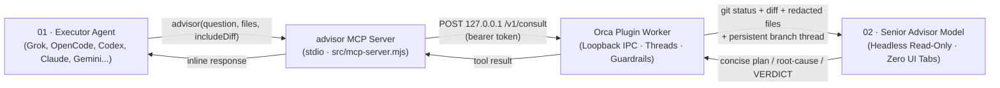

<p align="center">
  
</p>

<h1 align="center">Agent Advisor for Orca</h1>

<p align="center">
  <strong>Fast local execution backed by an on-demand senior model — invisibly, inside any agent in Orca.</strong><br/>
  Modeled on Anthropic's Claude Code <code>/advisor</code> workflow, built natively for <a href="https://orca.stably.ai">Orca</a> v2 plugins.
</p>

<p align="center">
  <a href="./README.md"><strong>English</strong></a> · <a href="./README.ru.md">Русский</a>
</p>

<p align="center">
  
  
  
  <a href="./LICENSE"></a>
</p>

---

## Table of Contents

- [Why Agent Advisor?](#why-agent-advisor)
- [How It Works](#how-it-works)
- [Key Capabilities](#key-capabilities)
- [Supported Providers & Live Model Discovery](#supported-providers--live-model-discovery)
- [Advisor Level Presets](#advisor-level-presets)
- [Installation](#installation)
- [Zero-Config Auto-Setup](#zero-config-auto-setup)
- [Panel & Settings Reference](#panel--settings-reference)
- [Security & Privacy](#security--privacy)
- [Development & Testing](#development--testing)
- [License](#license)

---

## Why Agent Advisor?

Running a frontier reasoning model on every grep, file edit, and test rerun is slow and expensive. Running a fast model alone leads to subtle architectural mistakes, tunnel vision, and debugging loops.

**Agent Advisor** brings the **two-tier reasoning pattern** (popularized by Claude Code's `/advisor`) to **every coding agent running inside Orca** — whether you work in `Grok`, `OpenCode`, `Codex`, `Claude Code`, `Gemini`, `Kilocode`, `Cline`, or `Antigravity`:

- Your **executor agent** keeps full control of files, terminals, and fast iterations.
- When it hits a non-trivial design fork, gets stuck repeating failing commands, or finishes a major diff, it silently calls the read-only `advisor` MCP tool.
- The **senior advisor model** runs **headlessly in the background** (zero extra chat tabs cluttering your Orca workspace), inspects the live git diff, requested files, and persistent branch thread, and returns concise, high-signal guidance straight back into the executor's context.

---

## How It Works



1. **Zero UI clutter:** Consultations run silently in headless read-only mode (`codex exec --sandbox read-only`, `claude -p --tools ""`, `grok --prompt-file --output-format json`, `gemini --approval-mode plan`, or direct HTTP APIs). No stray advisor tabs are spawned in your workspace.
2. **Persistent per-branch memory:** Conversations are stored in `orca.storage` keyed by workspace and branch (resetting cleanly on branch switch), with prompt caching supported for Anthropic and OpenRouter.
3. **Automatic context assembly:** The worker collects `git status`, staged & unstaged `git diff` (within configurable byte limits), requested workspace files (guarded against path traversal and binary files), and optional terminal tail — automatically redacting detected secrets before anything leaves the machine.

---

## Key Capabilities

- **Minimal Single-Screen Panel** — Open from Orca's status bar (`Advisor`) or with `Mod+Shift+A`:
  - Master **On / Off** toggle
  - Unified **Provider** selector (auto-populated from `orca agent installed` + API providers)
  - Live **Model** picker (pulls your actual available models — never stale hardcoded lists)
  - Independent **Thinking / Effort** selector (`default`, `low`, `medium`, `high`, `xhigh`, `max`)
  - **Advisor level** presets (**Rare** / **Balanced** / **Frequent**)
  - Contextual live status during active handoffs, loop alerts, and collapsible recent advice
- **Zero-Config MCP & `/advisor` Skill Registration** — Automatically wires up installed local agents and installs the `/advisor` skill on startup.
- **Passive Guardrails** — Soft per-turn MCP call budget (`maxUsesPerTurn`), `agent.tool.after` loop detector with 1-click unstick, and `agent.status.changed` post-finish diff checks.
- **Zero Runtime Dependencies** — Pure TypeScript + Node.js built-ins + Orca Components UI.
- **Bilingual Support** — Full English and Russian UI (switches automatically with Orca's locale) plus bilingual `RU · EN` plugin settings.

---

## Supported Providers & Live Model Discovery

| Provider | Execution Mode | Extra Orca Tab? | Model Discovery Source |
| :--- | :--- | :---: | :--- |
| **Codex** | Headless `codex exec --sandbox read-only` | No | `~/.codex/models_cache.json` + `~/.codex/config.toml` |
| **Claude** | Headless `claude -p --tools ""` | No | `~/.claude/settings.json` + live `ANTHROPIC_BASE_URL/v1/models` |
| **Grok** | Headless `grok --prompt-file --output-format json` | No | Live `grok models` + `~/.grok/config.toml` |
| **Gemini** | Headless `gemini -p "" --approval-mode plan` | No | `~/.gemini/settings.json` |
| **OpenCode / OpenCode 2** | Native Orca Agent (`orca agent launch`) | Fallback | Live `opencode models` |
| **Kilocode** | Native Orca Agent (`orca agent launch`) | Fallback | Live `kilo models` |
| **Cline / Antigravity** | Native Orca Agent (`orca agent launch`) | Fallback | Local settings / Orca default |
| **OpenRouter API** | Direct HTTPS + prompt caching | No | Live `https://openrouter.ai/api/v1/models` |
| **Anthropic API** | Direct HTTPS + `cache_control: ephemeral` | No | Live `https://api.anthropic.com/v1/models` |
| **OpenAI / Compatible API** | Direct HTTPS (`customBaseUrl` supported) | No | Live `<baseUrl>/models` |

> **Per-provider memory:** Switching providers automatically saves and restores your preferred model for each provider/agent.

---

## Advisor Level Presets

Pick a preset in the Advisor panel without tweaking individual knobs. Changing the preset **preserves** your chosen model and **Thinking / Effort** level.

| Level | Autonomous MCP Budget / Turn | Loop Threshold | Post-Finish Diff Check | Best For |
| :--- | :---: | :---: | :---: | :--- |
| **Rare** (`rare`) | `2` | `4` repeated failures | Off | Fast flow; consult only when blocked or at major forks |
| **Balanced** (`balanced`) | `4` | `3` repeated failures | Suggest | Default everyday workflow |
| **Frequent** (`frequent`) | `8` | `2` repeated failures | Automatic review | High-stakes refactors, migrations, and unfamiliar codebases |

---

## Installation

### Option 1: Install via Orca CLI (from Git)

```bash
orca plugin install https://github.com/aElDi/orca-agent-advisor --json
```

Inspect the requested capabilities and approve with the printed fingerprint.

### Option 2: Load Locally for Development

```bash
git clone https://github.com/aElDi/orca-agent-advisor.git
cd orca-agent-advisor
orca plugin dev load . --json
```

Orca will display the plugin's capability grants and an approval fingerprint. Confirm and run:

```bash
orca plugin dev load . --json --approve <fingerprint>
```

Open the panel anytime by clicking **Advisor** in Orca's bottom status bar or pressing `Ctrl+Shift+A` (`Cmd+Shift+A` on macOS).

---

## Zero-Config Auto-Setup

When `autoConnectAgents` is enabled (default: `true`), starting the plugin automatically:

1. Starts an authenticated loopback IPC server on `127.0.0.1` (random port, per-session CSPRNG bearer token in `~/.orca-agent-advisor/ipc.json` with `0600` permissions).
2. Registers the zero-dependency stdio MCP bridge (`src/mcp-server.mjs`) in every detected local agent without overwriting your existing config:
   - **Claude Code** (`claude mcp add --scope user`)
   - **Codex CLI** (`codex mcp add`)
   - **OpenCode** (`~/.config/opencode/opencode.json`)
   - **Grok** (`grok mcp add --scope user` / `~/.grok/config.toml`)
   - **Gemini CLI** (`~/.gemini/settings.json`)
   - **Antigravity** (`~/.gemini/antigravity/mcp_config.json`)
   - **Cline** (`~/.cline/data/settings/cline_mcp_settings.json`)
   - **Kilocode** (`~/.config/kilo/kilo.json`)
3. Installs the global `/advisor` skill at `~/.agents/skills/advisor/SKILL.md` and mirrors it into installed agent skill folders (`~/.codex/skills`, `~/.grok/skills`, `~/.gemini/skills`, `~/.claude/skills`).

To disable automatic registration and manage configs manually, turn off **Auto-connect agents & skill** (`autoConnectAgents`) in Orca's plugin Settings.

---

## Panel & Settings Reference

### Commands & Shortcuts

| Command | Shortcut | Description |
| :--- | :--- | :--- |
| `Advisor: Open Panel` (`advisor.open`) | `Mod+Shift+A` | Opens the Advisor panel in Orca's right sidebar |
| `Advisor: Consult on Current Workspace` (`advisor.consult`) | — | Runs a workspace sanity-check consultation |
| `Advisor: Review Current Git Diff` (`advisor.reviewDiff`) | — | Audits current git diff with `VERDICT: LGTM` / `CHANGES_REQUESTED` |
| `Advisor: Start New Thread` (`advisor.newThread`) | — | Resets the workspace advisor conversation history |
| `Advisor: Reset Turn Call Budget` (`advisor.resetBudget`) | — | Resets the per-turn autonomous MCP counter |
| `Advisor: Toggle Loop Detection` (`advisor.toggleLoopDetector`) | — | Enables or disables `agent.tool.after` loop monitoring |

### Key Settings (in Orca Settings → Agent Advisor)

All power-user knobs live cleanly in Orca's plugin Settings: `enabled`, `advisorLevel`, `autoConnectAgents`, `backend`, `orcaAgent`, `model`, `reasoningEffort`, `customBaseUrl`, `maxUsesPerTurn`, `loopDetectionEnabled`, `loopThreshold`, `postFinishReviewMode`, `autoInjectReviewFixes`, `minDiffLinesForReview`, `injectPromptGuidance`, `maxDiffChars`, `redactSecrets`, `notifyOnAlerts`, and `customSystemPrompt`.

---

## Security & Privacy

- **Read-only by design:** Every advisor backend runs strictly read-only (sandboxed CLI flags or tool-less prompt calls) and cannot modify your files or execute mutating commands.
- **Recursion guard:** Codex and Claude headless advisor runs automatically strip the `advisor` MCP tool from the advisor subprocess so it can never recursively call itself.
- **Secret redaction:** Common API keys, tokens, and private key blocks are redacted before leaving your machine (`redactSecrets: true`), and sensitive files (`.env`, `.pem`, `.key`, credentials) are refused by the workspace file reader.
- **Path containment:** Requested files are canonicalized and verified to stay strictly inside the active workspace root.
- **OS keyring storage:** Optional API keys (OpenRouter, Anthropic, OpenAI) are stored exclusively via Orca's encrypted `secrets` API (`secrets:own`).
- **Loopback-only IPC:** The local MCP bridge binds only to `127.0.0.1` and validates a timing-safe random bearer token on every request.

---

## Development & Testing

```bash
# 1. Generate Orca plugin typings
orca plugin types . --json

# 2. Typecheck & syntax-check the standalone MCP server
npx tsc -p . --noEmit
node --check src/mcp-server.mjs

# 3. Validate manifest & run unit / worker / panel tests
orca plugin validate . --json
orca plugin test . --json

# 4. Run declarative panel check scenarios
orca plugin check . --json
```

Optional live end-to-end test (queries live model catalogs, tests local CLIs, and executes a real stdio MCP → IPC → CLI round-trip):

```powershell
$env:ADVISOR_LIVE_E2E='1'; orca plugin test . --json
```

### Project Structure

```text
orca-agent-advisor/
├── assets/
│   ├── cover.jpg               # 1600x1000 Swiss-editorial plugin cover
│   ├── icon.png                # 256x256 plugin tile icon
│   └── mark.png                # 256x256 transparent panel mark
├── src/
│   ├── worker.ts               # Trusted worker entry, RPC, hooks, events, commands
│   ├── panel.tsx               # Minimal Orca Components control panel
│   ├── advisor.ts              # Consultation orchestration & prompt assembly
│   ├── context.ts              # Git diff, safe file reader, secret redaction
│   ├── guards.ts               # Loop detector, turn tracker, verdict parser
│   ├── ipc.ts                  # Authenticated 127.0.0.1 loopback IPC bridge
│   ├── mcp-server.mjs          # Zero-dependency stdio MCP server (`advisor` tool)
│   ├── mcp-setup.ts            # Auto-registration for 8 local agents + /advisor skill
│   ├── models.ts               # Live model catalog discovery across all providers
│   ├── threads.ts              # Persistent per-workspace branch threads & stats
│   ├── i18n.ts                 # English & Russian UI strings
│   ├── protocol.ts             # Typed worker <-> panel RPC contract
│   ├── types.ts                # Shared domain types & preset definitions
│   └── providers/              # Headless CLIs (codex, claude, grok, gemini), Orca, APIs
├── orca-plugin.json            # Orca v2 plugin manifest
├── CHANGELOG.md
└── LICENSE
```

---

## License

MIT © 2026 [aElDi](https://github.com/aElDi)
