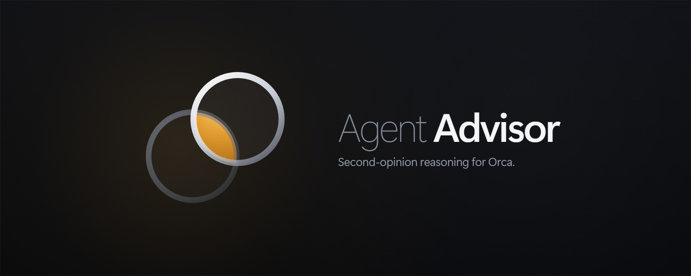
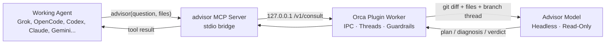

<p align="center">
  
</p>

<p align="center">
  <a href="./README.md"><strong>English</strong></a> · <a href="./README.ru.md">Русский</a>
</p>

<p align="center">
  
  
  
  <a href="./LICENSE"></a>
</p>

---

**Agent Advisor** brings the two-tier reasoning workflow popularized by **Anthropic's Claude Code `/advisor`** to every coding agent inside [Orca](https://orca.stably.ai).

The idea is simple: let a fast model handle day-to-day edits, searches, and test runs, and summon a stronger senior model only when it actually matters — on a tricky architectural decision, a stubborn debugging loop, or a final diff check before wrapping up.

Everything happens quietly behind the scenes. Your working agent calls the `advisor` MCP tool, the senior model reasons in headless read-only mode, and the answer lands straight back inside the same conversation. No extra chat tabs, no manual copy-pasting, no context switching.

---

## Contents

- [How It Works](#how-it-works)
- [Features](#features)
- [Providers & Models](#providers--models)
- [Advisor Levels](#advisor-levels)
- [Installation](#installation)
- [Automatic Setup](#automatic-setup)
- [Commands & Settings](#commands--settings)
- [Security](#security)
- [Development](#development)

---

## How It Works



When the executor agent asks for advice, the worker automatically gathers `git status`, the current `git diff`, any files the agent requested, and the workspace's ongoing advisor thread. Secrets are redacted before anything leaves the machine. The advisor model responds in strict read-only mode, and the thread stays persisted per branch in `orca.storage` so follow-up questions keep full continuity.

---

## Features

- **Inspired by Claude Code `/advisor`, built for all of Orca** — Works with `Grok`, `OpenCode`, `Codex`, `Claude Code`, `Gemini`, `Kilocode`, `Cline`, and `Antigravity`.
- **Invisible headless execution** — `Codex`, `Claude`, `Grok`, `Gemini`, and direct APIs run silently in the background without opening extra tabs in your workspace.
- **Minimal control panel** — Click **Advisor** in Orca's status bar or press `Mod+Shift+A` to toggle it on/off, pick a provider, choose a model, adjust reasoning effort, and set how often it steps in.
- **Real model lists, never stale defaults** — Reads your actual available models directly from local agent caches, CLIs, or live APIs.
- **Independent Thinking / Effort control** — Tune reasoning depth (`low`, `medium`, `high`, `xhigh`, `max`) right beside the model picker without overwriting it when switching frequency presets.
- **Automatic MCP & `/advisor` setup** — Registers the `advisor` tool across your installed agents and installs the global `/advisor` skill automatically on startup.
- **Built-in guardrails** — Soft per-turn call budget, loop detection when an agent repeats failing commands, and optional diff review checks after large edits.
- **Zero runtime dependencies** — Pure TypeScript, Node.js built-ins, and native Orca Components UI with English and Russian localization.

---

## Providers & Models

| Provider | Execution | Extra Tab | Model Source |
| :--- | :--- | :---: | :--- |
| **Codex** | Headless `codex exec --sandbox read-only` | No | `~/.codex/models_cache.json` and `config.toml` |
| **Claude** | Headless `claude -p --tools ""` | No | `~/.claude/settings.json` and live `/v1/models` |
| **Grok** | Headless `grok --prompt-file --output-format json` | No | Live `grok models` and `config.toml` |
| **Gemini** | Headless `gemini -p "" --approval-mode plan` | No | `~/.gemini/settings.json` |
| **OpenCode / OpenCode 2** | Native Orca agent | Fallback | Live `opencode models` |
| **Kilocode** | Native Orca agent | Fallback | Live `kilo models` |
| **Cline / Antigravity** | Native Orca agent | Fallback | Local config or Orca default |
| **OpenRouter API** | Direct HTTPS with prompt caching | No | `openrouter.ai/api/v1/models` |
| **Anthropic API** | Direct HTTPS with prompt caching | No | `api.anthropic.com/v1/models` |
| **OpenAI / Compatible API** | Direct HTTPS with custom base URL support | No | `<baseUrl>/models` |

Switching providers automatically remembers the model you last used for each one.

---

## Advisor Levels

Instead of tuning ten separate thresholds, pick one of three presets directly in the panel. Changing the level keeps your chosen model and reasoning effort intact.

| Level | Calls per Turn | Loop Warning | Post-Finish Diff Check | When to Use |
| :--- | :---: | :---: | :---: | :--- |
| **Rare** | `2` | After `4` repeats | Off | Uninterrupted flow; step in only when stuck or at major forks |
| **Balanced** | `4` | After `3` repeats | Suggest | Everyday default |
| **Frequent** | `8` | After `2` repeats | Auto-review | Complex refactors, migrations, and high-risk changes |

---

## Installation

### From Git via Orca CLI

```bash
orca plugin install https://github.com/aElDi/orca-agent-advisor --json
```

Review the permissions Orca prints and confirm with the provided fingerprint.

### Local Development

```bash
git clone https://github.com/aElDi/orca-agent-advisor.git
cd orca-agent-advisor
orca plugin dev load . --json
```

Then approve the displayed fingerprint:

```bash
orca plugin dev load . --json --approve <fingerprint>
```

Open the panel anytime from the **Advisor** button in Orca's bottom bar or via `Ctrl+Shift+A` / `Cmd+Shift+A`.

---

## Automatic Setup

On startup, with `autoConnectAgents` enabled by default, the worker handles all wiring automatically:

1. Launches an authenticated loopback IPC bridge on `127.0.0.1` with a per-session random bearer token.
2. Registers the `advisor` stdio MCP server across every installed agent it detects on your machine: **Claude Code**, **Codex CLI**, **OpenCode**, **Grok**, **Gemini CLI**, **Antigravity**, **Cline**, and **Kilocode**.
3. Installs the `/advisor` skill to `~/.agents/skills/advisor/SKILL.md` and syncs it into installed agent skill directories.

If you prefer managing agent configs manually, disable **Auto-connect agents & skill** in Orca Settings.

---

## Commands & Settings

| Command | Shortcut | What It Does |
| :--- | :--- | :--- |
| `Advisor: Open Panel` | `Mod+Shift+A` | Opens the Advisor sidebar panel |
| `Advisor: Consult on Current Workspace` | — | Runs a quick workspace sanity-check |
| `Advisor: Review Current Git Diff` | — | Audits the current diff with `LGTM` or `CHANGES_REQUESTED` |
| `Advisor: Start New Thread` | — | Clears the current workspace's advisor history |
| `Advisor: Reset Turn Call Budget` | — | Resets the per-turn autonomous MCP call counter |
| `Advisor: Toggle Loop Detection` | — | Turns `agent.tool.after` loop monitoring on or off |

Advanced options — custom OpenAI-compatible base URL, diff size caps, secret redaction, notifications, and additional system instructions — are available in **Orca Settings → Agent Advisor** in both English and Russian.

---

## Security

- **Strict read-only execution** — Advisors run sandboxed or tool-less and cannot edit files or run mutating commands.
- **No recursive self-calls** — Headless Codex and Claude advisor subprocesses strip the `advisor` MCP tool automatically.
- **Secret redaction & path safety** — Common API keys, bearer tokens, and private keys are masked before leaving the machine; sensitive files such as `.env`, `.pem`, and `.key` are skipped, and file reads are locked inside the workspace root.
- **Encrypted API keys** — Optional API keys are stored exclusively in the OS keyring via Orca's `secrets` API.
- **Loopback-only bridge** — Local IPC binds strictly to `127.0.0.1` with constant-time bearer token verification.

---

## Development

```bash
orca plugin types . --json
npx tsc -p . --noEmit
node --check src/mcp-server.mjs
orca plugin validate . --json
orca plugin test . --json
orca plugin check . --json
```

To run the optional live end-to-end suite against local CLIs and live catalogs:

```powershell
$env:ADVISOR_LIVE_E2E='1'; orca plugin test . --json
```

---

## Credits & License

Inspired by Anthropic's **Claude Code `/advisor`** multi-model strategy.  
MIT © 2026 [aElDi](https://github.com/aElDi)
