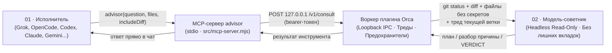

<p align="center">
  
</p>

<h1 align="center">Agent Advisor для Orca</h1>

<p align="center">
  <strong>Быстрая рабочая модель + старший советник по запросу — невидимо, для любого агента внутри Orca.</strong><br/>
  Вдохновлено воркфлоу <code>/advisor</code> из Claude Code, создано нативно для плагинов <a href="https://orca.stably.ai">Orca</a> v2.
</p>

<p align="center">
  <a href="./README.md">English</a> · <a href="./README.ru.md"><strong>Русский</strong></a>
</p>

<p align="center">
  
  
  
  <a href="./LICENSE"></a>
</p>

---

## Содержание

- [Зачем нужен Agent Advisor](#зачем-нужен-agent-advisor)
- [Как это работает](#как-это-работает)
- [Возможности](#возможности)
- [Провайдеры и автоподгрузка моделей](#провайдеры-и-автоподгрузка-моделей)
- [Уровни советчика](#уровни-советчика)
- [Установка](#установка)
- [Автоподключение без ручной настройки](#автоподключение-без-ручной-настройки)
- [Команды и настройки](#команды-и-настройки)
- [Безопасность и приватность](#безопасность-и-приватность)
- [Разработка и тестирование](#разработка-и-тестирование)
- [Лицензия](#лицензия)

---

## Зачем нужен Agent Advisor

Гонять самую дорогую и медленную модель на каждый `grep`, правку пары строк и прогон тестов — долго и дорого. Работать только на быстрой модели — риск поймать архитектурную ошибку, зациклиться на падающих тестах или упустить тонкий баг в diff.

**Agent Advisor** переносит паттерн **двухступенчатого рассуждения** (как `/advisor` в Claude Code) на **всех агентов в Orca** — `Grok`, `OpenCode`, `Codex`, `Claude Code`, `Gemini`, `Kilocode`, `Cline` и `Antigravity`:

- **Лёгкий исполнитель** быстро пишет код, запускает команды и ведёт диалог в вашем чате.
- На сложной архитектурной развилке, при зацикливании или перед завершением крупных правок он сам вызывает read-only MCP-инструмент `advisor`.
- **Старшая модель-советник** отрабатывает **невидимо в фоне** (не создавая лишних чатов и вкладок в воркспейсе), видит актуальный `git diff`, запрошенные файлы и историю ветки, и возвращает сжатый, точный план прямо в контекст исполнителя.

---

## Как это работает



1. **Никаких лишних чатов в Orca:** `Codex`, `Claude`, `Grok`, `Gemini` и API-провайдеры работают полностью скрыто в headless read-only режиме — ответ приходит прямо в ваш активный чат исполнителя.
2. **Память по веткам:** история консультаций хранится в `orca.storage` отдельно для каждого воркспейса и автоматически сбрасывается при смене ветки. Для Anthropic и OpenRouter включён prompt caching.
3. **Автосбор контекста:** воркер сам собирает `git status`, `git diff`, запрошенные файлы (с защитой от path traversal и бинарников) и при необходимости хвост терминала — предварительно маскируя найденные секреты.

---

## Возможности

- **Минималистичная панель управления** — открывается кликом по `Advisor` в нижней строке Orca или по `Ctrl+Shift+A` (`Cmd+Shift+A` на macOS):
  - Главный тумблер **Вкл / Выкл**
  - Единый выбор **Провайдера** (подтягивается из установленных агентов Orca + API)
  - Живой список **Моделей** (подтягивает именно ваши реальные модели)
  - Независимый выбор **Рассуждений (Effort)** (`default`, `low`, `medium`, `high`, `xhigh`, `max`)
  - Пресеты **Уровня советчика** (**Редко** / **Средне** / **Часто**)
  - Контекстные живые блоки только во время реальной работы (индикатор вызова, алерт зацикливания, свёрнутая история последних советов)
- **Автоподключение «из коробки»** — сам регистрирует `advisor` MCP во все установленные агенты и ставит скилл `/advisor`.
- **Предохранители** — лимит автономных обращений за ход, детектор зацикливания (`agent.tool.after`) и проверка крупных непроверенных diff после завершения работы агента (`agent.status.changed`).
- **Ноль runtime-зависимостей** — чистый TypeScript, встроенные модули Node.js и нативные компоненты Orca.

---

## Провайдеры и автоподгрузка моделей

| Провайдер | Режим выполнения | Лишняя вкладка в Orca? | Откуда подтягиваются модели |
| :--- | :--- | :---: | :--- |
| **Codex** | Скрытый headless `codex exec --sandbox read-only` | Нет | `~/.codex/models_cache.json` + `~/.codex/config.toml` |
| **Claude** | Скрытый headless `claude -p --tools ""` | Нет | `~/.claude/settings.json` + живой `ANTHROPIC_BASE_URL/v1/models` |
| **Grok** | Скрытый headless `grok --prompt-file --output-format json` | Нет | Живой `grok models` + `~/.grok/config.toml` |
| **Gemini** | Скрытый headless `gemini -p "" --approval-mode plan` | Нет | `~/.gemini/settings.json` |
| **OpenCode / OpenCode 2** | Нативный агент Orca (`orca agent launch`) | Fallback | Живой `opencode models` |
| **Kilocode** | Нативный агент Orca (`orca agent launch`) | Fallback | Живой `kilo models` |
| **Cline / Antigravity** | Нативный агент Orca (`orca agent launch`) | Fallback | Локальный конфиг / дефолт Orca |
| **OpenRouter API** | Прямой HTTPS + prompt caching | Нет | Живой `https://openrouter.ai/api/v1/models` |
| **Anthropic API** | Прямой HTTPS + `cache_control: ephemeral` | Нет | Живой `https://api.anthropic.com/v1/models` |
| **OpenAI / Compatible API** | Прямой HTTPS (поддержка `customBaseUrl`) | Нет | Живой `<baseUrl>/models` |

---

## Уровни советчика

Готовые пресеты в панели позволяют настроить частоту вмешательства в один клик. Переключение пресета **не сбрасывает** выбранную вами модель и уровень **Рассуждений (Effort)**.

| Уровень | Лимит MCP за ход | Порог зацикливания | Проверка diff в конце | Когда использовать |
| :--- | :---: | :---: | :---: | :--- |
| **Редко** (`rare`) | `2` | `4` повтора | Выкл | Быстрый поток; советник только в тупиках и на ключевых развилках |
| **Средне** (`balanced`) | `4` | `3` повтора | Предлагать | Сбалансированный режим по умолчанию |
| **Часто** (`frequent`) | `8` | `2` повтора | Авто-ревью | Сложные рефакторинги, миграции и незнакомый код |

---

## Установка

### Вариант 1: Установка из Git через Orca CLI

```bash
orca plugin install https://github.com/aElDi/orca-agent-advisor --json
```

Проверьте запрашиваемые права и подтвердите установку с выданным отпечатком.

### Вариант 2: Локальная загрузка для разработки

```bash
git clone https://github.com/aElDi/orca-agent-advisor.git
cd orca-agent-advisor
orca plugin dev load . --json
```

Подтвердите загрузку командой с отпечатком, которую выведет Orca:

```bash
orca plugin dev load . --json --approve <fingerprint>
```

---

## Автоподключение без ручной настройки

При включённой настройке `autoConnectAgents` (по умолчанию `true`) плагин при старте сам:

1. Поднимает защищённый локальный IPC-сервер на `127.0.0.1` со случайным портом и bearer-токеном (`~/.orca-agent-advisor/ipc.json`).
2. Неразрушающе регистрирует MCP-сервер `advisor` во всех найденных локальных агентах:
   - **Claude Code**, **Codex CLI**, **OpenCode**, **Grok**, **Gemini CLI**, **Antigravity**, **Cline**, **Kilocode**.
3. Устанавливает глобальный скилл `/advisor` в `~/.agents/skills/advisor/SKILL.md` и синхронизирует его в папки скиллов установленных агентов (`~/.codex/skills`, `~/.grok/skills`, `~/.gemini/skills`, `~/.claude/skills`).

---

## Команды и настройки

| Команда | Горячая клавиша | Назначение |
| :--- | :--- | :--- |
| `Advisor: Open Panel` (`advisor.open`) | `Mod+Shift+A` | Открыть панель Advisor справа |
| `Advisor: Consult on Current Workspace` (`advisor.consult`) | — | Запустить проверку текущего состояния воркспейса |
| `Advisor: Review Current Git Diff` (`advisor.reviewDiff`) | — | Провести аудит `git diff` с вердиктом `LGTM` / `CHANGES_REQUESTED` |
| `Advisor: Start New Thread` (`advisor.newThread`) | — | Начать новый тред советника для текущего воркспейса |
| `Advisor: Reset Turn Call Budget` (`advisor.resetBudget`) | — | Сбросить счётчик автономных вызовов за ход |
| `Advisor: Toggle Loop Detection` (`advisor.toggleLoopDetector`) | — | Включить/выключить детектор зацикливания |

Все тонкие параметры (свой `Base URL`, лимиты diff, маскирование секретов, доп. системный промпт, уведомления) доступны на двух языках (**RU · EN**) в стандартных **Настройках Orca → Agent Advisor**.

---

## Безопасность и приватность

- **Строгий read-only:** советник не может менять файлы или выполнять мутирующие команды.
- **Защита от рекурсии:** в headless-запусках Codex и Claude MCP-инструмент `advisor` автоматически отключается, чтобы советник не мог вызвать сам себя.
- **Маскирование секретов:** API-ключи, токены и приватные ключи маскируются до отправки (`redactSecrets: true`), а файлы `.env`, `.pem`, `.key` блокируются при чтении.
- **Системный keyring:** ключи API (если используете OpenRouter / Anthropic / OpenAI) хранятся в зашифрованном хранилище Orca (`secrets:own`).
- **Только `127.0.0.1`:** IPC-мост слушает исключительно loopback с проверкой случайного токена.

---

## Разработка и тестирование

```bash
orca plugin types . --json
npx tsc -p . --noEmit
node --check src/mcp-server.mjs
orca plugin validate . --json
orca plugin test . --json
orca plugin check . --json
```

Живой E2E-прогон (живые каталоги моделей, проверка CLI и сквозной MCP stdio-запрос):

```powershell
$env:ADVISOR_LIVE_E2E='1'; orca plugin test . --json
```

---

## Лицензия

MIT © 2026 [aElDi](https://github.com/aElDi)
