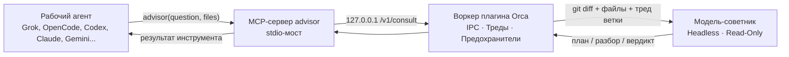

<p align="center">
  
</p>

<p align="center">
  <a href="./README.md">English</a> · <a href="./README.ru.md"><strong>Русский</strong></a>
</p>

<p align="center">
  
  
  
  <a href="./LICENSE"></a>
</p>

---

**Agent Advisor** переносит идею команды **`/advisor` из Claude Code** на любых агентов внутри [Orca](https://orca.stably.ai).

Идея простая: рутинные правки, поиск по коду и запуск тестов делает быстрая рабочая модель, а старшая модель-советник подключается только в нужный момент — на сложной архитектурной развилке, при зацикливании на ошибках или для финального ревью перед завершением задачи.

Всё происходит незаметно в фоне. Рабочий агент сам вызывает MCP-инструмент `advisor`, старшая модель анализирует контекст в скрытом read-only режиме, и её совет возвращается прямо в текущий чат. Никаких лишних вкладок в воркспейсе и ручной пересылки контекста.

---

## Содержание

- [Как это работает](#как-это-работает)
- [Возможности](#возможности)
- [Провайдеры и модели](#провайдеры-и-модели)
- [Уровни советчика](#уровни-советчика)
- [Установка](#установка)
- [Автоподключение](#автоподключение)
- [Команды и настройки](#команды-и-настройки)
- [Безопасность](#безопасность)
- [Разработка](#разработка)

---

## Как это работает



Когда агент обращается за советом, воркер сам собирает `git status`, актуальный `git diff`, запрошенные файлы и историю предыдущих консультаций по текущей ветке. Найденные секреты маскируются до отправки. Советник работает строго в режиме только чтения, а переписка сохраняется в `orca.storage` отдельно для каждой ветки, чтобы уточняющие вопросы не теряли контекст.

---

## Возможности

- **Вдохновлено `/advisor` из Claude Code, работает со всей Orca** — Поддерживаются `Grok`, `OpenCode`, `Codex`, `Claude Code`, `Gemini`, `Kilocode`, `Cline` и `Antigravity`.
- **Невидимая работа в фоне** — `Codex`, `Claude`, `Grok`, `Gemini` и прямые API выполняются в скрытом headless-режиме, не засоряя воркспейс лишними чатами.
- **Лаконичная панель управления** — Открывается кликом по **Advisor** в нижней строке Orca или по `Ctrl+Shift+A`: тумблер вкл/выкл, провайдер, модель, глубина рассуждений и частота советов.
- **Только реальные модели** — Список моделей подтягивается из локальных кэшей агентов, их CLI или живых API без устаревших хардкодов.
- **Отдельный выбор глубины рассуждений** — Уровень `Effort` (`low`, `medium`, `high`, `xhigh`, `max`) выставляется прямо рядом с моделью и не сбрасывается при смене пресета частоты.
- **Автоподключение из коробки** — При старте плагин сам регистрирует `advisor` MCP во все установленные агенты и ставит скилл `/advisor`.
- **Предохранители** — Лимит автономных вызовов за ход, детектор зацикливания на повторяющихся ошибках и проверка крупных правок после завершения работы агента.
- **Ноль внешних зависимостей** — Чистый TypeScript, встроенные модули Node.js и нативные компоненты Orca на русском и английском языках.

---

## Провайдеры и модели

| Провайдер | Режим запуска | Лишняя вкладка | Откуда берутся модели |
| :--- | :--- | :---: | :--- |
| **Codex** | Headless `codex exec --sandbox read-only` | Нет | `~/.codex/models_cache.json` и `config.toml` |
| **Claude** | Headless `claude -p --tools ""` | Нет | `~/.claude/settings.json` и живой `/v1/models` |
| **Grok** | Headless `grok --prompt-file --output-format json` | Нет | Живой `grok models` и `config.toml` |
| **Gemini** | Headless `gemini -p "" --approval-mode plan` | Нет | `~/.gemini/settings.json` |
| **OpenCode / OpenCode 2** | Нативный агент Orca | Fallback | Живой `opencode models` |
| **Kilocode** | Нативный агент Orca | Fallback | Живой `kilo models` |
| **Cline / Antigravity** | Нативный агент Orca | Fallback | Локальный конфиг или дефолт Orca |
| **OpenRouter API** | Прямой HTTPS с prompt caching | Нет | `openrouter.ai/api/v1/models` |
| **Anthropic API** | Прямой HTTPS с prompt caching | Нет | `api.anthropic.com/v1/models` |
| **OpenAI / Compatible API** | Прямой HTTPS со своим Base URL | Нет | `<baseUrl>/models` |

Для каждого провайдера плагин запоминает последнюю выбранную модель отдельно.

---

## Уровни советчика

Вместо ручной настройки десятка параметров достаточно выбрать один из трёх пресетов. Выбранная модель и уровень рассуждений при этом сохраняются.

| Уровень | Вызовов за ход | Порог зацикливания | Проверка diff | Для каких задач |
| :--- | :---: | :---: | :---: | :--- |
| **Редко** | `2` | После `4` повторов | Выкл | Максимально быстрая работа; совет только в тупиках и на ключевых развилках |
| **Средне** | `4` | После `3` повторов | Предлагать | Сбалансированный режим на каждый день |
| **Часто** | `8` | После `2` повторов | Авто-ревью | Сложный рефакторинг, миграции и критичные участки кода |

---

## Установка

### Из Git через Orca CLI

```bash
orca plugin install https://github.com/aElDi/orca-agent-advisor --json
```

Просмотрите запрошенные права и подтвердите установку выданным отпечатком.

### Локальная установка для разработки

```bash
git clone https://github.com/aElDi/orca-agent-advisor.git
cd orca-agent-advisor
orca plugin dev load . --json
```

Подтвердите загрузку с выданным отпечатком:

```bash
orca plugin dev load . --json --approve <fingerprint>
```

Панель открывается кликом по **Advisor** в нижней строке статуса Orca или сочетанием `Ctrl+Shift+A` / `Cmd+Shift+A`.

---

## Автоподключение

По умолчанию включена настройка `autoConnectAgents`. При запуске плагин сам:

1. Поднимает локальный IPC-мост на `127.0.0.1` со случайным bearer-токеном сессии.
2. Неразрушающе регистрирует MCP-сервер `advisor` во всех найденных на компьютере агентах: **Claude Code**, **Codex CLI**, **OpenCode**, **Grok**, **Gemini CLI**, **Antigravity**, **Cline** и **Kilocode**.
3. Устанавливает глобальный скилл `/advisor` в `~/.agents/skills/advisor/SKILL.md` и синхронизирует его в папки скиллов установленных агентов.

Если вы хотите управлять конфигами агентов вручную, отключите **Автоподключение MCP и /advisor** в настройках плагина.

---

## Команды и настройки

| Команда | Сочетание | Что делает |
| :--- | :--- | :--- |
| `Advisor: Open Panel` | `Mod+Shift+A` | Открывает боковую панель советника |
| `Advisor: Consult on Current Workspace` | — | Быстрая проверка текущего состояния воркспейса |
| `Advisor: Review Current Git Diff` | — | Аудит текущего diff с вердиктом `LGTM` или `CHANGES_REQUESTED` |
| `Advisor: Start New Thread` | — | Сбрасывает историю переписки с советником для текущего воркспейса |
| `Advisor: Reset Turn Call Budget` | — | Сбрасывает счётчик автономных обращений за ход |
| `Advisor: Toggle Loop Detection` | — | Включает или отключает детектор зацикливания |

Тонкие настройки — свой OpenAI-совместимый Base URL, лимит размера diff, маскирование секретов, уведомления и дополнительные инструкции — находятся в **Настройках Orca → Agent Advisor** на русском и английском языках.

---

## Безопасность

- **Строгий read-only** — Советник запускается в песочнице или без инструментов и не может менять файлы или выполнять команды.
- **Защита от рекурсии** — При headless-запуске Codex и Claude инструмент `advisor` автоматически отключается у самого советника.
- **Защита секретов и путей** — API-ключи, bearer-токены и приватные ключи маскируются до отправки; чувствительные файлы вроде `.env`, `.pem` и `.key` пропускаются, а чтение файлов ограничено корнем воркспейса.
- **Шифрованное хранение ключей** — Опциональные API-ключи хранятся в системном кейринге через API секретов Orca.
- **Только `127.0.0.1`** — IPC-сервер слушает исключительно локальный loopback с проверкой токена в постоянном времени.

---

## Разработка

```bash
orca plugin types . --json
npx tsc -p . --noEmit
node --check src/mcp-server.mjs
orca plugin validate . --json
orca plugin test . --json
orca plugin check . --json
```

Живой сквозной тест против локальных CLI и каталогов моделей:

```powershell
$env:ADVISOR_LIVE_E2E='1'; orca plugin test . --json
```

---

## Благодарности и лицензия

Идея вдохновлена стратегией **`/advisor`** в Claude Code от Anthropic.  
MIT © 2026 [aElDi](https://github.com/aElDi)
